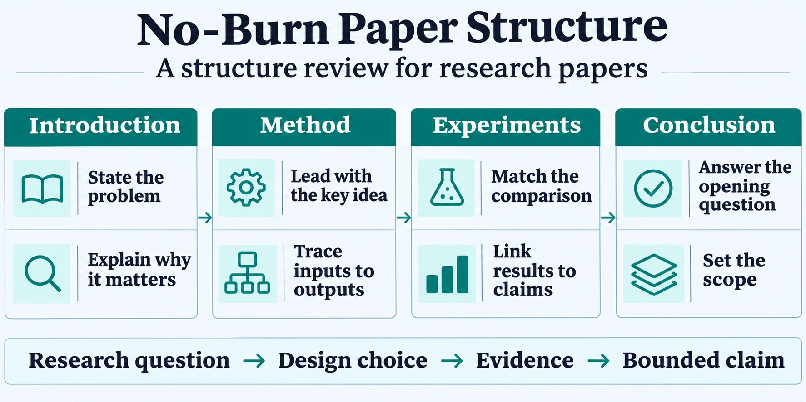

# No-Burn Paper Structure | 不烧型论文结构审阅

[简体中文](README.zh-CN.md) · [Worked example](examples/plan.html)

This Codex skill reviews the structure of a research paper. Give it a draft and whatever notes, results, or figures you have. It traces the main argument through the sections, shows where the supplied evidence fits, and prioritizes the changes that would make the paper easier to follow.

I built it from paper discussions with advisors who had different styles across several Top 30 CS departments. One practice kept coming up. State the research problem in the opening paragraph, then explain why it matters. With even half a draft, you can review whether the methods and experiments answer that opening question.



## Review the argument section by section

| Section | What the reader should be able to follow |
|---|---|
| **Introduction** | The research problem, why it matters, the gap in prior work, and the idea the paper puts forward. |
| **Method** | How the key idea determines the inputs, operations, and outputs, with the rationale for consequential choices. |
| **Experiments and results** | Which question each comparison answers, what the metric and display show, and which claim the result supports. |
| **Conclusion** | The answer to the opening question, the conditions it holds under, and what remains open. |

In the worked example, the introduction can open with “Can page position and section headings help a reranker retrieve the correct evidence passage from a scientific PDF?”

## See what a review returns


In the fictional example, a layout-aware reranker improves top-ranked passage matches from 12 to 15 on the same 24 questions from single-column PDFs (`E02`). A larger export includes two-column PDFs and omits question IDs and candidate-pool hashes (`E03`). The review keeps the pilot result in the paper and marks the cross-layout comparison as pending. The first check (`G01`) is to recover the matching question IDs, gold annotations, and candidate pools.

The review opens with the conclusion the supplied evidence can support. It links each material claim to its source, orders the checks that would change the argument, and proposes a section outline. Gray notes show the next action at a gap, with space reserved for pending figures and tables. The final table records what to keep, move, split, or add in each section, along with priority and a completion check.

[Example source packet](examples/source-packet.md) · [Full annotated review](examples/plan.html) (download the HTML and open it in a browser)

## Run in Codex

Clone into your Codex skills directory, then open a new chat.

```sh
git clone https://github.com/ArthurQQQQ/advisor-ready-paper-structure.git "${CODEX_HOME:-$HOME/.codex}/skills/advisor-ready-paper-structure"
```

Attach the draft and any notes, results, figures, or tables you want the review to use. Include the target venue if it affects the structure.

```text
Use $advisor-ready-paper-structure to review the structure of the attached paper.
Trace the main argument through the sections and link the claims to the supplied evidence.
Flag the biggest gap, suggest an outline, and give me a prioritized section review table.
```
