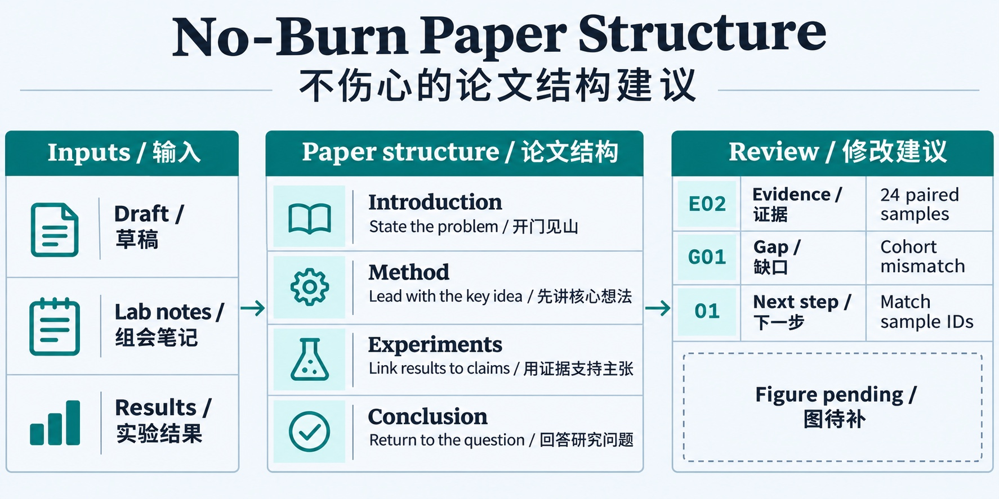

# 不伤心的论文结构建议

**No-Burn Paper Structure**

我在几所 Top 30 CS 院系和不同风格的导师讨论论文时，记下了几种反复用到的写法。比如引言第一段先让读者知道你在解决什么问题，再讲它为什么值得解决。我把这些写法做成了一个 Codex 技能。即使只有半份草稿和几张实验表，也可以用它确定哪些结论有证据、各节先写什么、下一步核对什么。

I built this Codex skill from paper discussions with advisors of different styles across several Top 30 CS departments. One practice kept coming up. State the research problem in the opening paragraph, then explain why it matters. Bring a partial draft and whatever results you have, and work out what you can claim, what belongs in each section, and which check to run next.

[看完整示例 / See the worked example](examples/plan.html)



## 逐节搭建论证 · Build the argument section by section

| 章节 / Section | 写作顺序 / Writing sequence |
|---|---|
| **Introduction** | 研究问题 → 为什么重要 → 相关工作留下的缺口 → 核心想法 → 证据预告<br>Research problem → stakes → gap in prior work → key idea → evidence preview |
| **Method** | 核心想法 → 输入 → 关键操作及设计理由 → 输出<br>Key idea → inputs → operations and design rationale → outputs |
| **Experiments / Results** | 实验问题 → 对照、指标和读图方式 → 观测 → 解释 → 支持哪条主张<br>Question → comparison, metric, and how to read the display → observation → interpretation → claim it supports |
| **Conclusion** | 回答引言的问题 → 主要发现和适用范围 → 从局限推导后续工作<br>Answer to the opening question → findings and scope → future work tied to a limitation |

引言可以直接问“页面位置和小节标题能否帮助检索器在学术 PDF 中找到正确的证据段落？”

An introduction can open with “Can page position and section headings help a reranker retrieve the correct evidence passage from a scientific PDF?”

## 证据能支持多强的结论 · Scope the claim to the evidence

虚构示例中，加入版面信息后，在同一组来自单栏 PDF 的 24 个问题上，首位段落的精确匹配数从 12 增到 15（`E02`）。更大的导出混入了双栏 PDF，缺少问题 ID 和候选池哈希（`E03`）。先写配对试验的观察，把跨版式结论留待核对。第一步（`G01`）是核对问题 ID、参考标注和候选池，确定哪些样本能配对。

In the fictional example, adding layout cues raises top-ranked passage exact matches from 12 to 15 on the same 24 questions from single-column PDFs (`E02`). The larger export also includes two-column PDFs and lacks question IDs and candidate-pool hashes (`E03`). Report the paired pilot observation now. Check question IDs, gold annotations, and candidate pools to find eligible pairs (`G01`) before making a claim across layouts.

输出会把**当前结论、证据位置及适用范围、分析顺序**放在前面。随后给出带灰色旁注的逐节提纲和待填的图表，最后用修改表列明每节的待补内容和完成标准。

The review starts with the **current conclusion, evidence locations and scope, and analysis order**. It gives you a section outline with gray notes and blank figure or table slots, then ends with a review table specifying what to revise and how to tell when it is done.

[示例材料 / Example source packet](examples/source-packet.md) · [完整输出 / Full annotated example](examples/plan.html)（下载 HTML 后用浏览器打开 / Download the HTML and open it in a browser）

## 在 Codex 中使用 · Run in Codex

把仓库克隆到 Codex 技能目录。已安装可直接在新聊天里用。

Clone into your Codex skills directory. If already installed, start a new chat.

```sh
git clone https://github.com/ArthurQQQQ/advisor-ready-paper-structure.git "${CODEX_HOME:-$HOME/.codex}/skills/advisor-ready-paper-structure"
```

附上草稿、组会笔记、实验结果或图表。有目标会议或期刊可一并说明。然后复制一条提示词。

Attach any draft sections, meeting notes, results, or figures. Include your target venue if you have one, then copy either prompt.

**中文**

```text
用 $advisor-ready-paper-structure 看我附的草稿、组会笔记和实验表。
告诉我证据支持什么结论、结论适用于哪些条件，以及哪项核对最先做。
给我中英双语的逐节写作建议。英文提纲的缺口用灰色中文小字写明下一步，
待补图表留空，最后给我一张逐节修改表。
```

**English**

```text
Use $advisor-ready-paper-structure on my draft, meeting notes, and results.
Tell me what the evidence supports, under what conditions, and which check to do first.
Give me bilingual section guidance and an English outline with short gray Chinese notes at the gaps,
blank slots for pending figures and tables, and a section-by-section review.
```
