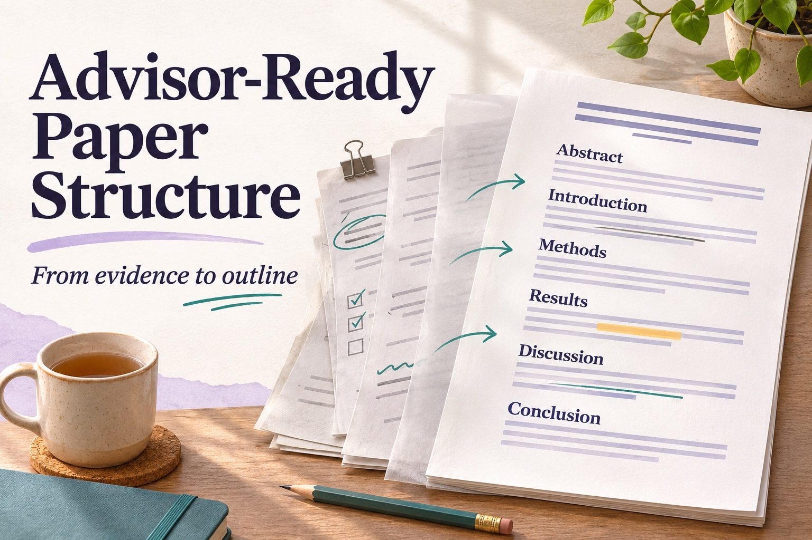
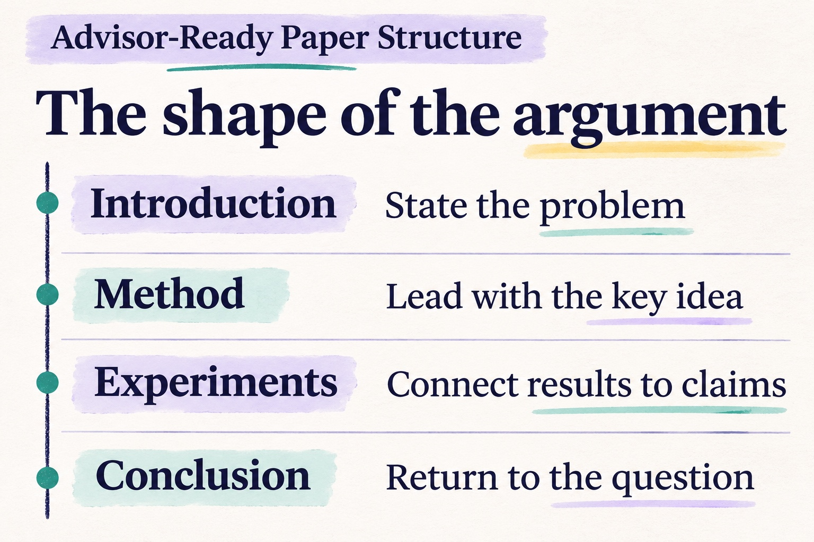

# 导师会喜欢的论文结构

**Advisor-Ready Paper Structure**

我在几所 Top 30 的 CS 院系和不同风格的导师讨论论文时，整理了他们看重的一些写法。比如 Introduction 开门见山，第一段就交代具体的研究问题，再说明为什么值得解决。哪怕手上只有半份草稿和几张实验表，这个技能也会从已有材料出发，告诉你哪一段能先写、哪里需要补证据。

I put this guide together from paper discussions with advisors who had different styles across several Top 30 CS departments. One practice I kept coming back to was opening the introduction with the research problem, then explaining why it matters. Bring a partial draft and whatever results you have. The skill will show you what you can write today and what evidence to gather next.

[先看一份输出 / See a sample output](examples/plan.html)



## 快速开始 · Quick start

**1. 安装 / Install.** 第一次用时，把仓库克隆到你的 Codex 技能目录。已安装可以直接跳到第 2 步。<br>
Clone the repository into your Codex skills directory. If the skill is already installed, start at step 2.

```sh
git clone https://github.com/ArthurQQQQ/advisor-ready-paper-structure.git "${CODEX_HOME:-$HOME/.codex}/skills/advisor-ready-paper-structure"
```

**2. 提供材料 / Add your materials.** 在 Codex 新聊天中附上已有的草稿、组会笔记、实验结果或图表。有目标期刊或会议时，可以一并说明。<br>
In a new Codex chat, attach or point to any mix of draft sections, meeting notes, results, figures, and tables. Include a target venue if you have one.

**3. 调用技能 / Run the skill.** 复制一条提示词发给 Codex。 / Copy either prompt into Codex.

**中文**

```text
用 $advisor-ready-paper-structure 看我附的草稿、组会笔记和实验表。
先告诉我现有证据能支持什么结论、哪项分析应该先做。
再给我逐节写作提纲。英文提纲的缺口用灰色中文小字注明，
待补的图表留空，最后给我一张逐节修改表。
```

**English**

```text
Use $advisor-ready-paper-structure on my draft, meeting notes, and results.
Tell me what the evidence supports today and which analysis to do first.
Give me an English outline with short gray Chinese notes at the gaps,
empty slots for pending figures and tables, and a section-by-section review.
```

## 每节怎么写 · What each section does

**引言的第一段就可以这样开头。** “页面位置和小节标题能否帮助检索器在学术 PDF 中找到正确的证据段落？”读者知道了问题，你就可以接着讲它为什么重要、已有方法留下了什么问题。

**An introduction can open like this.** “Can page position and section headings help a reranker retrieve the correct evidence passage from a scientific PDF?” Once the reader knows the question, explain why it matters and where current approaches fall short.



| 章节 / Section | 写作顺序 / Writing sequence |
|---|---|
| **Introduction** | 研究问题 → 为什么重要 → 现有缺口 → 核心想法和证据预告<br>Research problem → stakes → remaining gap → key idea and evidence preview |
| **Method** | 核心想法 → 输入 → 关键操作 → 输出<br>Key idea → inputs → main operations → outputs |
| **Experiments / Results** | 要回答的问题 → 对照和图表读法 → 观察 → 解释 → 对方法意味着什么<br>Question → comparison and how to read the display → observation → interpretation → implication for the method |
| **Conclusion** | 回答开头的问题 → 主要发现及适用范围 → 源于局限的后续工作<br>Answer to the opening question → finding and scope → future work tied to a limitation |

## 你会拿到什么 · What you get back

1. **当前结论 / Current conclusion.** 现有材料能支持什么，以及结论适用于哪些条件。<br>What the supplied evidence supports and under which conditions.
2. **证据索引与分析顺序 / Evidence map and analysis order.** 每条主张对应哪份材料，先做哪个对照或核对哪项设置。<br>Where to find each claim’s evidence and which comparison or check to do first.
3. **带批注的章节提纲 / Annotated outline.** 每节要回答什么。在缺口原位用另一种语言的灰色小字标明下一步，待补图表保留空位。<br>What each section should answer, with small gray notes in a second language at the gaps and blank space for pending displays.
4. **逐节修改表 / Section-by-section review.** 每节的已有证据、待补逻辑、建议动作、优先级和完成标准。<br>The evidence, gap, recommended action, priority, and completion check for each section.


### 示例 · Worked example

这份虚构材料里，带版面信息的方法在同一组 24 道单栏 PDF 题目上命中 15 道，基线命中 12 道。更大一批结果的测试样本不同，所以提纲先记录这个小样本的观察，优先核对更大批次能否配对，再给完整对照图表留位。

In the fictional packet, the layout-aware method finds 15 correct passages and the baseline finds 12 on the same 24 questions from single-column PDFs. The larger export uses different samples, so the plan records the pilot observation, puts a sample-matching check first, and reserves space for the full comparison.

- [示例输入 / Example source packet](examples/source-packet.md)
- [完整输出 / Full annotated example](examples/plan.html) · 下载 HTML 后用浏览器打开 / Download the HTML and open it in a browser
