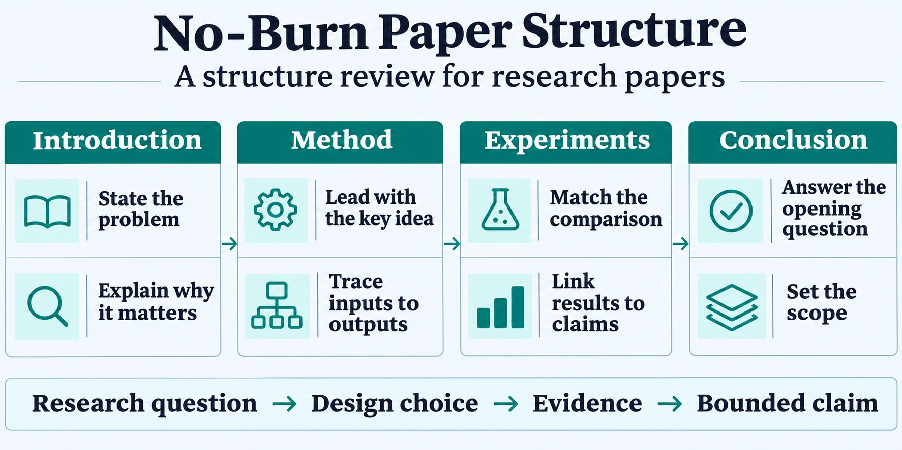
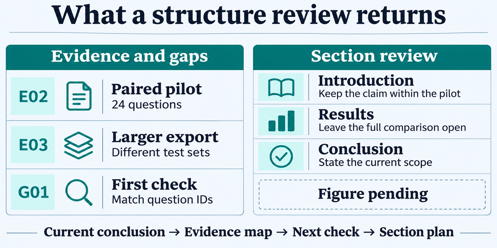

# 不烧型论文结构审阅

[English](README.md) · [完整审阅示例](examples/plan.html)

这是一个审阅论文结构的 Codex 技能。交给它现有的草稿、笔记、结果或图表，它会顺着各节检查论文的论证，把关键主张对应到已有证据，并列出优先修改的地方。

我在几所 Top 30 CS 院系和不同风格的导师讨论论文时，反复遇到一个建议。引言第一段先交代研究问题，再解释为什么值得解决。即使草稿只写了一半，也可以先检查方法和实验能否回答开头的问题。



## 逐节检查论证

| 章节 | 读者应能顺着理解什么 |
|---|---|
| **引言** | 研究问题、为什么重要、相关工作留下的缺口，以及本文提出的核心想法。 |
| **方法** | 核心想法怎样决定输入、操作和输出，关键设计为什么这样做。 |
| **实验与结果** | 每组对照回答什么问题，指标和图表显示什么，结果能支持哪条主张。 |
| **结论** | 开头问题的答案、答案成立的条件，以及还有哪些问题待解决。 |

示例里的引言可以开门见山地问“页面位置和小节标题能否帮助重排器在学术 PDF 中找到正确的证据段落？”

## 审阅输出



在虚构示例中，两种配置用同一组来自单栏 PDF 的 24 个问题进行检索，加入版面信息后，首位段落精确匹配数从 12 增到 15（`E02`）。更大的导出包含双栏 PDF，却缺少问题 ID 和候选池哈希（`E03`）。审阅建议保留配对试验的观察，暂将跨版式对照标为待补，并把恢复对应的问题 ID、参考标注和候选池列为第一项检查（`G01`）。

审阅先交代已有证据能支持什么结论，再列出主张对应的材料、会改变论证的检查顺序和建议提纲。缺口处用灰色旁注写明下一步，并为待补图表留位。最后的逐节审阅表给出保留、移动、拆分或补充的建议，并注明优先级和完成标准。

[示例材料](examples/source-packet.md) · [完整审阅输出](examples/plan.html)（下载 HTML 后用浏览器打开）

## 在 Codex 中使用

将仓库克隆到 Codex 技能目录，再开启一个新聊天。

```sh
git clone https://github.com/ArthurQQQQ/advisor-ready-paper-structure.git "${CODEX_HOME:-$HOME/.codex}/skills/advisor-ready-paper-structure"
```

附上论文草稿、笔记、实验结果或图表。如果目标会议或期刊影响章节结构，可以一并说明。

```text
用 $advisor-ready-paper-structure 审阅附件里的论文结构。
检查主线如何贯穿各节，把关键主张对应到附件中的证据。
指出最大的缺口，给我建议提纲和按优先级排列的逐节审阅表。
```
