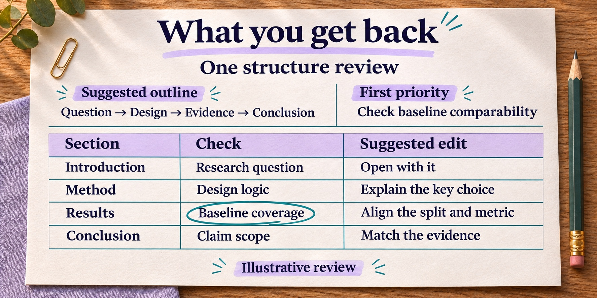

# 不烧心的论文结构审阅

**按论证逻辑重组你的论文。**

我把和世界各地顶尖高校的教授一起做研究、为机器学习和 AI 主流会议写论文的经验，整理成了这份指南。它帮你用清晰的论证结构讲明白你的研究，让读者从中学到东西。

上传论文 PDF，得到一份可离线打开的交互式 HTML 结构审阅报告。

[English](README.md) · [完整审阅示例](examples/plan.html)

## 从一个想法开始

在 Codex 里用一句话说出你大概想研究什么。

```text
用 $advisor-ready-paper-structure 跟我讨论这个研究想法。
检索长文档时，能不能提前停读，又找齐需要的证据？
```

1. **反复推敲五个问题。** 我们研究什么、为什么值得做、难在哪里、前人怎么做、我们的思路是什么。每轮先讨论最影响研究的一处缺口，过程中查相关原论文，把新依据和修改记到研究墙上。
2. **确认题目和比较方案。** 研究问题与主张清楚后，确认当前简报，再固定正式基线、对照和评价条件。
3. **选择写作结构。** 写作前先根据主要贡献与证据判断是 method paper 还是 analysis paper，说明理由，再生成对应的 Quick Paper。缺少的证据、实验和结论保留为空位。

在研究墙上查看每轮的对话摘录、更新的论文积木和待补证据。让 Codex 打开实时预览，页面会随对话更新。生成的 `research-workspace.html` 也可以离线打开。写作时直接编辑 `quick-paper.md`。把两份示例 HTML 下载到同一目录，再用浏览器打开。 [交互式想法示例](examples/research-idea-workbench.html) · [带已核查基线的工作台](examples/research-workspace.html) · [Quick Paper Markdown](examples/quick-paper.md)

五问从领域背景和必要术语讲起，让初次接触这个方向的读者也能理解。最接近的前人工作逐篇用一两句讲清做法、已解决范围和剩余问题，并保留来源。核心思路先用不依赖具体模型和数据集的语言解释，复现细节再放进实验设置。Method paper 围绕方法与比较组织，analysis paper 围绕研究问题、分析设计和发现组织。

[五问框架与论文类型判定](references/research-framing.md)

[共同写作底层框架](references/writing-foundations.md)来自提供的 Writing tips，贯穿这些工作流。它规定核心洞见、五问后接实验概述与贡献清单、方法先直觉后数学、实验叙述顺序、可独立阅读的图表，以及短句和稳定术语。

## 研究案例

长文档证据案例展示了研究墙、冻结的 OpenRouter 证据流程和独立新题检查。新批次出现 7 个提前通过点，30 个通过答案中有 14 个经原文审读不充分。案例同时记录运行失败和评估前排除的题目。

[查看案例与冻结流程](examples/long-document-early-stop/README.zh-CN.md)

## 需要提供什么


附上论文 PDF，草稿只写了一半也可以。如果论文用到了 PDF 以外的结果或对照，附上相关笔记、图表或评估设置。如果目标会议或期刊影响章节安排，也可以说明。

如果希望批准后直接下载修订稿，请同时附上可编辑的 LaTeX 或 Markdown 源稿。

## 会拿到什么



打开 HTML，先看简短结论和中间的编号逻辑图。点选一个节点，左栏显示已有证据、具体缺口和修改建议，右栏跳到论文 PDF 原页并高亮对应段落。无法在原页定位时，右栏会说明情况并显示已核对的原文摘录。

红色表示应优先补齐的关键信息，黄色表示需要修改或核查，绿色表示可做的小改动。没有标记的节点无需修改。

可以在节点里逐条批准，也可以点顶部的 **一键批准**。有可编辑源稿时，批准会把拟好的替换文字应用到副本。ZIP 包含已修改的 LaTeX 或 Markdown 源文件、修订记录和批准清单。

选好改动后，点击 **在 Codex 中打开**。Codex 桌面端会打开一个已填好任务指令的新对话。确认后点击 **发送**，Skill 会生成修订文件，并根据已有材料核查批准项里的待查问题。浏览器未能打开 Codex 时，可以用 **复制任务指令**，粘贴到 Codex 对话里发送。

## 逐节检查论证

| 章节 | 读者应能顺着理解什么 |
|---|---|
| **引言** | 研究问题、为什么重要、相关工作留下的缺口，以及本文提出的核心想法。 |
| **方法** | 核心想法怎样决定输入、操作和输出，关键设计为什么这样做。 |
| **实验与结果** | 每个基线在检验什么，对照条件和指标是否清楚，以及结果能支持哪条主张。 |
| **结论** | 开头问题的答案、答案成立的条件，以及还有哪些问题待解决。 |

示例里的引言可以开门见山地问“页面位置和小节标题能否帮助重排器在学术 PDF 中找到正确的证据段落？”

## 审阅示例

在虚构示例中，两种配置用同一组来自单栏 PDF 的 24 个问题进行检索，加入版面信息后，首位段落精确匹配数从 12 增到 15（`E02`）。更大的导出包含双栏 PDF，却缺少问题 ID 和候选池哈希（`E03`）。审阅建议保留配对试验的观察，暂将跨版式对照标为待补，并把恢复对应的问题 ID、参考标注和候选池列为第一项检查（`G01`）。

[示例材料](examples/source-packet.md) · [交互审阅示例](examples/plan.html)（下载 HTML 后用浏览器打开）

## 在 Codex 中使用

将仓库克隆到 Codex 技能目录，再开启一个新聊天。

```sh
git clone https://github.com/ArthurQQQQ/advisor-ready-paper-structure.git "${CODEX_HOME:-$HOME/.codex}/skills/advisor-ready-paper-structure"
```

附上论文 PDF 和手头的可编辑源稿，再发下面这段提示。

```text
用 $advisor-ready-paper-structure 审阅我附上的论文 PDF。
沿着各节梳理论证，指出现有证据能支持哪些主张，以及哪一步缺推理、基线对照或证据。
交付一份可离线打开的 HTML 审阅，先给简短结论，再给编号逻辑图。
左栏显示一到两条具体改法，右栏在 PDF 原页高亮对应段落。
标注问题的严重程度，并提供逐条批准和一键批准。
在可编辑源稿里拟好有证据支撑的替换文字，并记录需要额外材料的核查事项。
```
